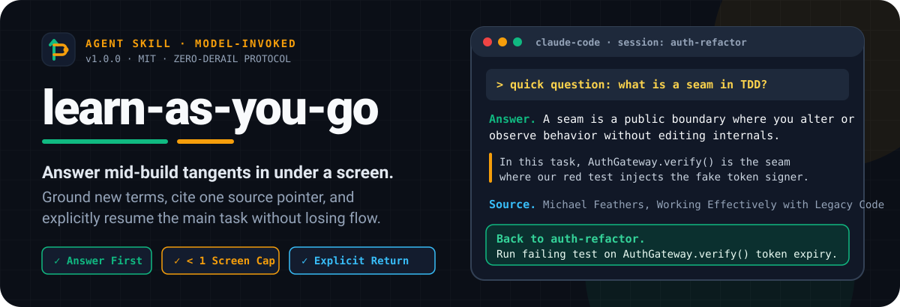
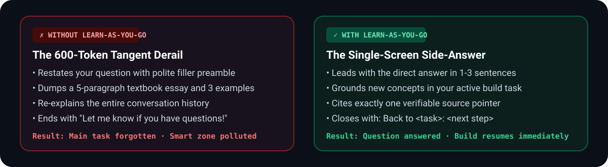
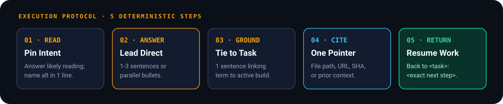
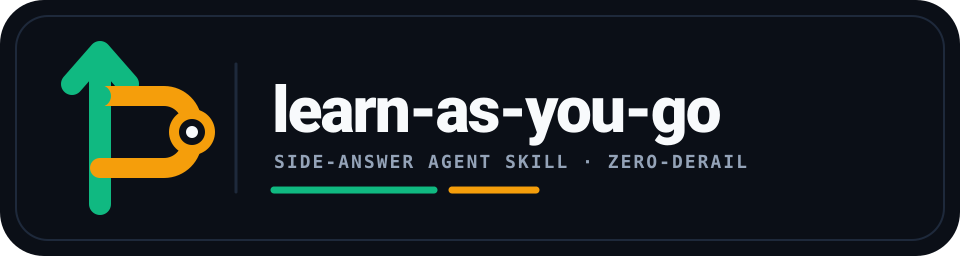
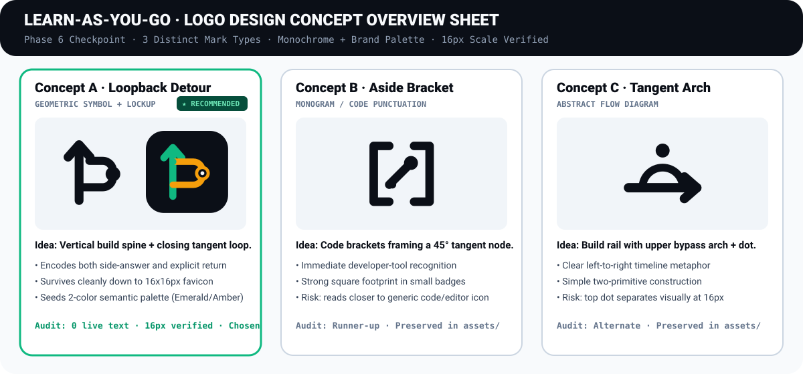

<p align="center">
  
</p>

<p align="center">
  <a href="./LICENSE"></a>
  <a href="./skills/learn-as-you-go/SKILL.md"></a>
  <a href="./brand/brand.yaml"></a>
  <a href="https://github.com/Tulip9ZZZA/learn-as-you-go/actions"></a>
</p>

**A tight side-answer skill for AI coding agents.** When you ask a mid-build tangent question (`"quick question"`, `"by the way"`, `"what's X?"`), `learn-as-you-go` answers in under a screen, grounds any new term in your active task, cites one source pointer, and explicitly returns to your build (`Back to <task>. <next step>`).

```bash
npx skills add Tulip9ZZZA/learn-as-you-go
```

## Why `learn-as-you-go` Exists

Mid-build questions are side-checks, not requests to abandon the current task. Without an explicit side-answer contract, coding agents treat a 5-word tangent as an invitation to write a 600-token tutorial, restate the prompt, re-summarize the conversation, and lose the implementation thread.

<p align="center">
  
</p>

## How It Works

<p align="center">
  
</p>

Every response follows one strict output contract:

```markdown
**Answer.** <1-3 sentences, or a short bullet list>

<optional: one-line grounding if a new term appeared>

**Source.** <one pointer>
**Back to <task>.** <next step>
```

## Install

### Option A: `npx skills` CLI (Claude Code, Cursor, Windsurf, Codex & 70+ Agents)

```bash
npx skills add Tulip9ZZZA/learn-as-you-go
npx skills add Tulip9ZZZA/learn-as-you-go -g   # install globally
```

### Option B: Claude Code Plugin Marketplace

```bash
/plugin marketplace add Tulip9ZZZA/learn-as-you-go
/plugin install learn-as-you-go@learn-as-you-go
```

### Option C: One-Command Setup Script (with `AGENTS.md` / `CLAUDE.md` Pointer)

Clone this repository and run the hardened scaffold script to drop `SKILL.md` into `.claude/skills/learn-as-you-go/` (or `--global`) and wire the context pointer into your `CLAUDE.md` or `AGENTS.md`:

```bash
git clone https://github.com/Tulip9ZZZA/learn-as-you-go.git
bash learn-as-you-go/scripts/setup-learn-as-you-go.sh --target /path/to/your/repo
# Or install globally:
bash learn-as-you-go/scripts/setup-learn-as-you-go.sh --global
```

### Option D: Manual Single-File Copy

Copy [`learn-as-you-go/SKILL.md`](./learn-as-you-go/SKILL.md) into `~/.claude/skills/learn-as-you-go/SKILL.md` (global) or `.claude/skills/learn-as-you-go/SKILL.md` (project).

## Why This Design (The Matt Pocock Lens)

Full architectural record: [`docs/adr/0001-model-invoked-side-answer-contract.md`](./docs/adr/0001-model-invoked-side-answer-contract.md) · Domain vocabulary: [`GLOSSARY.md`](./GLOSSARY.md).

| Design Lever | Rationale |
| :--- | :--- |
| **Model-invoked, not user-invoked** | The whole point is "quick question without interrupting." Forcing the human to type `/learn-as-you-go` every time defeats the quickness. The description costs one sentence of context load per turn; the savings from not over-contextualizing every side-answer dwarf it. |
| **"Under a screen" is the completion criterion** | It is checkable, exhaustive, and forces the brevity that vague bounds ("keep it short") lack. A fuzzy bound invites premature completion where visible steps ahead pull attention toward *being done* rather than *being tight*. One screen is a hard edge. |
| **"Answer first" is a leading word** | It recruits the model's pretraining priors about directness without spelling out "do not preamble, do not restate, do not hedge" as three separate rules. One token does the work of three. |
| **"Return explicitly" is the load-bearing rule** | Without it, a side-answer is a derail. With it, the skill is a detour that closes. The return line (`Back to <task>. <next step>`) is the contract: the main task resumes, or the side-answer failed. |
| **"Over-contextualizing" names the disease** | Existing implementations burn tokens by re-explaining the whole conversation. Naming the anti-pattern explicitly gives the agent a target to avoid, not just a positive rule to follow. |
| **No `/writing-shape` dependency** | The bullet-vs-prose rule ("Bullets for parallel items, prose for argument") is inlined as one line. A cross-skill pointer would cost context load every turn for a rule this skill needs on every invocation. |
| **`When not to use` is the honesty check** | A side-answer skill that fires on real design decisions, bug diagnoses, or codebase lookups is worse than no skill. This section tells both agent and human when the main flow is the right tool. |

## Brand Identity & Logo System

<p align="center">
  
</p>

`learn-as-you-go` ships with a complete, queryable [`brand/brand.yaml`](./brand/brand.yaml) package and pure-path SVG asset suite designed around **The Loopback Detour** mark: a vertical main-task spine in Return Emerald (`#10B981`) with a 45-degree tangent loop in Signal Amber (`#F59E0B`) that branches out to an answer node and merges cleanly back into the main build track.

<p align="center">
  
</p>

- **Brand Manifest & Docs**: [`brand/brand.yaml`](./brand/brand.yaml), [`brand/context.md`](./brand/context.md), [`brand/identity.md`](./brand/identity.md), [`brand/voice.md`](./brand/voice.md), [`brand/guidelines.md`](./brand/guidelines.md)
- **Production Vector Assets**: [`assets/logo.svg`](./assets/logo.svg), [`assets/logo-transparent.svg`](./assets/logo-transparent.svg), [`assets/logo-mark.svg`](./assets/logo-mark.svg), [`assets/logo-symbol-transparent.svg`](./assets/logo-symbol-transparent.svg), [`assets/logo-mono-black.svg`](./assets/logo-mono-black.svg), [`assets/logo-mono-white.svg`](./assets/logo-mono-white.svg), [`assets/favicon.svg`](./assets/favicon.svg), [`assets/concept-sheet.svg`](./assets/concept-sheet.svg)

## Repository Layout

```text
learn-as-you-go/
├── learn-as-you-go/
│   └── SKILL.md                 # Canonical standalone skill path
├── skills/
│   └── learn-as-you-go/
│       └── SKILL.md             # npx skills / Claude Code plugin skill path
├── .claude-plugin/
│   ├── plugin.json              # Claude Code plugin metadata
│   └── marketplace.json         # Strict plugin marketplace manifest
├── brand/
│   ├── brand.yaml               # Queryable Brand Package v1 manifest
│   ├── context.md               # Brand DNA, audience, and adjectives
│   ├── identity.md              # Logo direction, palette, and typography spec
│   ├── voice.md                 # Verbal identity and tone rules
│   └── guidelines.md            # Clear space, scale floor, and misuse rules
├── assets/
│   ├── logo.svg                 # Primary dark-tile horizontal lockup
│   ├── logo-transparent.svg     # Light-surface transparent lockup
│   ├── logo-mark.svg            # 256x256 symbol mark
│   ├── logo-mono-black.svg      # 1-color black symbol mark
│   ├── logo-mono-white.svg      # 1-color reversed white symbol mark
│   ├── favicon.svg              # 16px-64px small-size cut
│   ├── concept-sheet.svg        # Phase 6 3-concept overview & scale audit
│   └── readme/                  # 1200-unit GitHub-safe SVG visual story modules
├── docs/
│   ├── adr/0001-model-invoked-side-answer-contract.md
│   └── agents/                  # Domain & issue-tracker consumer pointers
├── scripts/
│   ├── setup-learn-as-you-go.sh # Project/global skill + AGENTS.md installer
│   ├── validate-skills.sh       # CI validation suite
│   └── audit_readme.py          # README SVG safety & link auditor
├── AGENTS.md                    # Root agent steering pointer
├── GLOSSARY.md                  # Ubiquitous domain vocabulary
├── SECURITY.md                  # Security guarantees & reporting policy
├── CONTRIBUTING.md              # Contribution & validation rules
└── LICENSE                      # MIT License
```

## Security & Quality Verification

Run the full validation suite locally at any time:

```bash
bash scripts/validate-skills.sh
```

## License

MIT License. See [`LICENSE`](./LICENSE).
